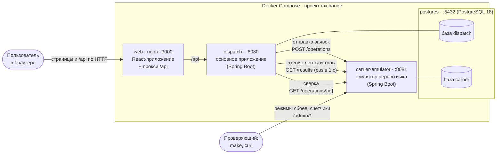
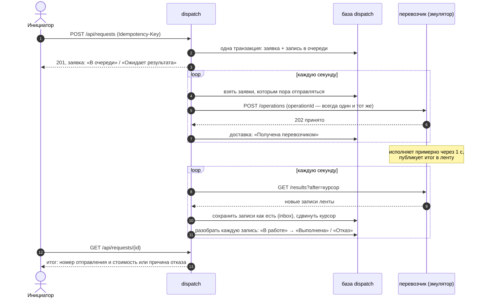

# Обмен с внешней системой

Тестовое задание по ТЗ `04-system-integration.md` (v2.1). Здесь описано, что это за система, как её запустить,
как она устроена и как её проверяли. Подробности по каждой теме лежат в `docs/`, ссылки по тексту.

## Содержание

1. [Что это за система](#1-что-это-за-система)
2. [Бизнес-процессы](#2-бизнес-процессы)
3. [Быстрый старт](#3-быстрый-старт)
4. [Из чего состоит система](#4-из-чего-состоит-система)
5. [Как заявка доходит до результата](#5-как-заявка-доходит-до-результата)
6. [Тайминги](#6-тайминги)
7. [Что бывает при сбоях](#7-что-бывает-при-сбоях)
8. [Проблемы, сверка и действия оператора](#8-проблемы-сверка-и-действия-оператора)
9. [Пользователи и права](#9-пользователи-и-права)
10. [API: основные методы](#10-api-основные-методы)
11. [Эмулятор перевозчика и режимы сбоев](#11-эмулятор-перевозчика-и-режимы-сбоев)
12. [Управление стендом: остановить, убить, восстановить](#12-управление-стендом-остановить-убить-восстановить)
13. [База данных и модель данных](#13-база-данных-и-модель-данных)
14. [Время, сроки и просрочка](#14-время-сроки-и-просрочка)
15. [Что тестировали и как](#15-что-тестировали-и-как)
16. [Нагрузочный тест](#16-нагрузочный-тест)
17. [Допущения](#17-допущения)
18. [Где мы отошли от ТЗ или выбрали своё](#18-где-мы-отошли-от-тз-или-выбрали-своё)
19. [Известные проблемы и недоработки](#19-известные-проблемы-и-недоработки)
20. [Для разработчика](#20-для-разработчика)

---

## 1. Что это за система

Компания принимает **заявки на доставку груза** и передаёт их внешней **службе доставки** (перевозчику). Перевозчик
исполняет заявку и сообщает итог: номер отправления и стоимость или отказ с причиной.

Связь с перевозчиком ненадёжна. Он бывает недоступен, ответ может потеряться, сообщение может прийти дважды или с
опозданием. Система должна:

- никогда не терять принятую заявку;
- не дать перевозчику исполнить одну заявку дважды;
- показывать честное состояние: «отправили», «перевозчик получил» и «исполнено» — это три разных факта;
- то, что нельзя решить автоматически, показывать человеку (оператору), а не решать молча.

Перевозчик в проекте ненастоящий. Это **эмулятор** — отдельное приложение со своей базой. Он умеет по команде
изображать сбои.

**Кто работает с системой:**

| Роль | Что делает |
|---|---|
| Инициатор | создаёт заявки и следит за своими заявками |
| Оператор интеграции | видит все заявки своей службы, следит за обменом, разбирает проблемы, повторяет отправку, сверяет данные с перевозчиком |
| Перевозчик (эмулятор) | принимает заявки, исполняет их и публикует итоги |

## 2. Бизнес-процессы

**1. Создание заявки (инициатор).** Инициатор заполняет форму: груз, вес, адрес, срок доставки. Затем проверяет данные
в окне «Проверьте данные» и нажимает «Создать». Заявка сохраняется и **в тот же момент** встаёт в очередь на отправку.
Черновиков нет. Содержимое после создания поменять нельзя: перевозчик уже мог начать работу.

**2. Передача перевозчику (система).** Фоновый процесс отправляет заявку перевозчику. Если перевозчик недоступен,
система повторяет попытки с растущими паузами. Пользователь об этом не заботится, он видит статус доставки.

**3. Исполнение и итог (перевозчик → система).** Перевозчик исполняет заявку и публикует итог в своей ленте
результатов. Система сама регулярно читает ленту и обновляет заявку: «В работе», затем «Выполнена» (номер отправления,
стоимость) или «Отказ» (причина).

**4. Сопровождение (инициатор и оператор).** Любой, кто видит заявку, может оставить комментарий. Оператор назначает
ответственного. Все изменения попадают в историю заявки: кто, когда, что было и что стало.

**5. Разбор проблем (оператор).** Если что-то пошло не так, система открывает **проблему**. Примеры: попытки отправки
кончились, ответ потерялся и неясно, получил ли перевозчик заявку, перевозчик прислал испорченное сообщение, итоги у нас
и у перевозчика разные. Оператор видит проблемы в списке «Проблемы» и в карточке заявки. Он выбирает разрешённое
действие: повторить отправку, принять версию перевозчика, оставить наш итог или отметить «Разобрано». К решению нужен
комментарий.

**6. Сверка (система и оператор).** Система периодически спрашивает перевозчика напрямую: «что у тебя с этой
заявкой?». Затем сравнивает ответ со своими данными. Совпадает — хорошо. У перевозчика итог есть, а у нас нет — система
забирает итог. Это единственное, что она делает сама. Любое другое расхождение становится проблемой для оператора.
Оператор может запустить сверку вручную кнопкой «Сверить сейчас».

## 3. Быстрый старт

**Что нужно:** Docker с Docker Compose. Больше ничего: Java, Node.js и база ставить не надо, всё собирается и
запускается в контейнерах. Платные внешние сервисы не используются.

```bash
cp .env.example .env    # один раз: настройки портов и паролей (демо-значения)
make up                 # собрать и запустить все контейнеры (первый раз несколько минут)
make seed               # создать демо-заявки (около минуты; нужны curl и jq)
```

Откройте **http://localhost:3000** и войдите одним из демо-пользователей. Пароль у всех: `demo1234`.

| Логин | Роль | Служба | Что увидит |
|---|---|---|---|
| `north.initiator` | инициатор | Север | только свои заявки, может создавать новые |
| `south.initiator` | инициатор | Юг | только свои заявки, может создавать новые |
| `north.operator` | оператор | Север | все заявки службы «Север», проблемы, обмен, сверку |

Проверить, что всё живо:

```bash
make ps                                        # состояние контейнеров
curl http://localhost:8080/actuator/health     # dispatch
curl http://localhost:8081/actuator/health     # эмулятор перевозчика
curl http://localhost:8080/api/system/info     # версия и часовой пояс
```

Если порт занят, поменяйте `DB_PORT`, `DISPATCH_PORT`, `CARRIER_PORT` или `WEB_PORT` в `.env`.

**Что создаёт `make seed`.** 14 заявок через API, как будто их создали пользователи. Поэтому у каждой настоящая
история обмена. Миграции базы заявок не создают.

| Заявки | Что показывают |
|---|---|
| 4 «Севера» и 3 «Юга» без сбоев | исходы «Выполнена» и «Отказ» (вес больше 10 000 кг или «тест-отказ» в адресе); у трёх есть ответственный и комментарий |
| «Холодильное оборудование» | перевозчик был недоступен: три попытки, затем «Выполнена» |
| «Медицинские расходники» | ответ потерялся: проблема «Неизвестно, получена ли» открылась и закрылась сама; у перевозчика две приёмки и одно исполнение |
| «Бумага офисная, 60 коробок» | перевозчик прислал итог дважды: применён один раз |
| «Электроника, 12 коробок» | испорченное сообщение: итог забрала сверка, открыта проблема «Некорректное сообщение», ждёт «Разобрано» |
| «Мебель для кафе, 30 мест» | перевозчик изменил итог у себя: открыто «Расхождение при сверке», ждёт решения |
| «Запчасти для насосов» | перевозчик потерял операцию, итог у нас есть: ждёт «Оставить наш итог» |
| «Спортивный инвентарь» | перевозчик потерял операцию до итога: ждёт «Повторить отправку» |

После сида у `north.operator` четыре открытые проблемы. Сид можно запускать повторно: новые заявки он не создаст.
Пошаговые ручные проверки всех сценариев описаны в `docs/manual-testing.md`.

## 4. Из чего состоит система



**Контейнеры** (`docker-compose.yml`):

| Контейнер | Что это | Порт | Лимит CPU / память |
|---|---|---|---|
| `postgres` | PostgreSQL 18, две отдельные базы: `dispatch` и `carrier` | 5432 | 0.6 / 1.25 ГиБ |
| `dispatch` | основное приложение: API, фоновая отправка, чтение ленты, сверка | 8080 | 0.8 / 1.5 ГиБ |
| `carrier-emulator` | эмулятор перевозчика со своей базой и режимами сбоев | 8081 | 0.4 / 0.75 ГиБ |
| `web` | nginx: отдаёт веб-приложение и проксирует `/api` в `dispatch` | 3000 | 0.2 / 64 МиБ |

Всего не больше 2 CPU и 4 ГиБ: это требование ТЗ (NF08).

**Главные решения устройства:**

- **dispatch и эмулятор не делят код.** Эмулятор изображает чужую систему, поэтому единственная договорённость между
  ними — контракт `contracts/carrier-api.yaml` (OpenAPI вместе с правилами обмена). Контракт веб-клиента —
  `contracts/dispatch-api.yaml`.
- **Очередь отправки в базе (outbox).** Пользовательский запрос никогда не ходит к перевозчику напрямую. Он сохраняет
  заявку и запись в очереди одной транзакцией, а отправляет фоновый процесс. Поэтому заявка не теряется, даже если
  перевозчик лежит или `dispatch` упал сразу после ответа пользователю.
- **Итоги забираются опросом (pull).** `dispatch` сам читает ленту итогов перевозчика и помнит, до какого места дочитал.
  Перевозчику не нужно до нас дозваниваться.
- **Получение итога отделено от его обработки (inbox).** Сначала запись ленты сохраняется как есть, потом её
  разбирает единый обработчик. Испорченная запись не останавливает чтение ленты.
- **Каждое действие с повтором защищено.** Отправка повторяется с тем же `operationId`, создание заявки и действия
  оператора требуют заголовок `Idempotency-Key`.

**Стек:** Java 25, Spring Boot 4, Spring Data JDBC и явный SQL (без JPA/Hibernate), Flyway, PostgreSQL 18; веб —
React 19, TypeScript, Vite, TanStack Router и Query, Mantine; всё запускается через Docker Compose и `make`.

## 5. Как заявка доходит до результата



Без сбоев заявка получает итог примерно за 2–3 секунды.

**У заявки два независимых статуса.** Так требует ТЗ: подтверждение получения ещё не значит исполнение.

| Статус доставки (что с передачей) | Что значит |
|---|---|
| В очереди (`PENDING`) | ещё не отправляли |
| Отправляется (`SENDING`) | отправляем прямо сейчас |
| Повтор отправки (`RETRY_WAIT`) | не получилось, ждём паузу и повторим |
| Неизвестно, получена ли (`UNKNOWN`) | ответа не дождались: перевозчик мог получить заявку, а мог и нет. Повторяем с тем же `operationId`, второго исполнения не будет |
| Получена перевозчиком (`ACKNOWLEDGED`) | перевозчик подтвердил приём: ответом, итогом в ленте или при сверке |
| Ошибка отправки (`FAILED`) | попытки кончились или перевозчик отверг запрос; решает оператор |

| Бизнес-результат (что с заказом) | Что значит |
|---|---|
| Ожидает результата (`AWAITING`) | перевозчик ещё ничего не сообщил |
| В работе (`IN_PROGRESS`) | перевозчик начал исполнять |
| Выполнена (`SUCCEEDED`) | есть номер отправления и стоимость |
| Отказ (`REJECTED`) | есть причина отказа |

Инициатору четыре промежуточных статуса доставки показываются одним словом «Отправляется»: технические подробности
ему не нужны. Оператор видит всё.

## 6. Тайминги

| Что | Значение | Где настроить |
|---|---|---|
| Отправка заявок | раз в 1 с, до 20 заявок за проход | `app.exchange.send-interval-ms`, `sends-per-pass` |
| Ожидание перевозчика | подключение 2 с, ответ 5 с | `CARRIER_CONNECT_TIMEOUT`, `CARRIER_READ_TIMEOUT` |
| Паузы между попытками отправки | 5 с, 10, 20, 40, 80, 160 с, затем 5 мин (удваиваются, со случайным разбросом) | `initial-backoff`, `max-backoff` |
| Сколько попыток | 8, это примерно 10 минут; потом «Ошибка отправки» и решение оператора | `max-attempts` |
| Захват заявки воркером | 60 с; если `dispatch` упал посреди отправки, после этого срока заявку отправят снова | `lease` |
| Чтение ленты итогов | раз в 1 с, до 100 записей за раз | `feed-interval-ms`, `feed-page-size` |
| Пауза ленты при сбое | 1 → 2 → … → 30 с, пока перевозчик недоступен или лента сломана | `feed-max-backoff` |
| Разбор записи ленты | до 5 попыток с паузой от 1 с до 1 мин, потом проблема «Не удалось обработать» | `inbox-*` |
| Фоновая сверка | при старте и раз в минуту, до 100 заявок за проход | `reconcile-interval`, `reconcile-per-pass` |
| Кого сверять | `UNKNOWN`, `FAILED` или «получена, но итога нет» дольше 2 мин, плюс заявки с открытой проблемой сверки | `reconcile-threshold` |
| Пауза перед повторной сверкой | 5 мин, удваивается до 1 ч, пока ответ не меняется | `reconcile-pause`, `reconcile-pause-max` |
| Исполнение у перевозчика | примерно через 1 с после приёма | `carrier.executor-interval-ms` |
| Сбой «потеря ответа» | ответ задерживается на 10 с (дольше, чем ждёт `dispatch`) | `CARRIER_LOSE_RESPONSE_DELAY` |
| Сбой «задержанный итог» | итог появляется в ленте через 15 с | `CARRIER_DELAYED_RESULT_DELAY` |
| Сессия входа | 30 мин без запросов, каждый запрос продлевает | — |
| Автообновление в интерфейсе | реестр раз в 10 с, карточка раз в 5 с (пока нет итога или открыта проблема) | — |

Настройки `app.exchange.*` лежат в `dispatch/.../exchange/ExchangeProperties.java`, значения по умолчанию указаны там же.

## 7. Что бывает при сбоях

| Ситуация | Что делает система | Что видно |
|---|---|---|
| Перевозчик недоступен | повторяет отправку с паузами; через ~10 мин сдаётся и открывает проблему | «Повтор отправки», затем «Ошибка отправки» и проблема |
| Ответ на отправку потерян | повторяет с тем же `operationId`; перевозчик узнаёт повтор и не исполняет второй раз | «Неизвестно, получена ли» и проблема, которая закроется сама при подтверждении |
| Итог пришёл дважды | второй экземпляр отсеивается по `messageId` | итог один, в журнале обмена видно число повторов |
| Итог пришёл с опозданием или раньше «В работе» | устаревшее сообщение не откатывает более новое состояние (сравнение по номеру в последовательности) | статусы идут только вперёд |
| Испорченное сообщение | не применяется, открывается проблема «Некорректное сообщение»; итог потом забирает сверка | проблема ждёт «Разобрано» |
| Упал `dispatch` | после старта продолжает с того места, где остановился: очередь и курсор ленты лежат в базе | всё доходит до итога, сессия пользователя цела |
| Упала база | приложения ждут; после её возвращения всё продолжается | пока база лежит, интерфейс показывает ошибки загрузки |
| Упал эмулятор | для `dispatch` это недоступность перевозчика | как в первой строке |

Гарантия: когда бы что ни упало и сколько бы ни лежало, каждая принятая заявка дойдёт до итога, ничего не потеряется,
и перевозчик ничего не исполнит дважды. Проверить это может сам перевозчик: у каждой операции `executionCount = 1`
(`make carrier-ops`).

## 8. Проблемы, сверка и действия оператора

**Проблема** — это то, что требует внимания человека. Она открывается и закрывается в той же транзакции, что и
событие, которое её вызвало.

| Проблема | Когда открывается | Кто и как закрывает |
|---|---|---|
| Неизвестно, получена ли заявка (`DELIVERY_UNKNOWN`) | ответ на отправку потерян | система, когда перевозчик подтвердит приём |
| Ошибка отправки (`DELIVERY_FAILED`) | попытки кончились или перевозчик отверг запрос | оператор: «Повторить отправку» |
| Некорректное сообщение (`INVALID_MESSAGE`) | запись ленты не соответствует контракту | оператор: «Разобрано» |
| Не удалось обработать (`MESSAGE_FAILED`) | `dispatch` не смог обработать запись | оператор: «Разобрано» |
| Расхождение итогов (`RESULT_CONFLICT`) | новая запись противоречит уже применённому итогу | оператор: «Принять версию перевозчика» или «Оставить наш итог» |
| Перевозчик не знает операцию (`EXTERNAL_MISSING`) | сверка: перевозчик не помнит заявку, которую подтвердил | система, если перевозчик снова её знает; иначе оператор: «Повторить» (итога нет) или «Оставить наш итог» |
| Расхождение при сверке (`RECONCILIATION_CONFLICT`) | сверка: итоги у нас и у перевозчика разные | система, если итоги совпали; иначе оператор: «Принять версию перевозчика» или «Оставить наш итог» |

**Исходы сверки:**

| Исход | Когда | Что делает система |
|---|---|---|
| Совпадает (`MATCH`) | расхождений нет | ничего |
| Итог получен сверкой (`EXTERNAL_AHEAD`) | у перевозчика итог есть, у нас нет | берёт итог: это единственное автоматическое правило |
| Перевозчик не знает операцию (`EXTERNAL_MISSING`) | перевозчик не помнит заявку | доставка «Неизвестно, получена ли» — отправляет сейчас; «Ошибка отправки» — ничего (повтор решает оператор); «Получена перевозчиком» — открывает проблему |
| Расхождение (`CONFLICT`) | итоги разные или итог есть только у нас | ничего не меняет, открывает проблему |
| Не удалось сверить (`ERROR`) | перевозчик недоступен или ответил не по контракту | записывает проверку, повторит позже |

Каждая проверка сохраняется. Оператор видит последние 20 в карточке, при расхождении две колонки: «Версия
перевозчика» и «Наш итог при обнаружении». Решение оператора (кто, когда, что, комментарий) хранится в проблеме и
попадает в историю заявки.

## 9. Пользователи и права

| | Инициатор | Оператор |
|---|---|---|
| Видит заявки | только свои | все заявки своей службы |
| Создаёт заявки | да | нет |
| Комментарий | в своих заявках | да |
| Назначает ответственного | нет | да, оператора своей службы |
| Техническая часть обмена, проблемы, сверка | нет | да |

- Права проверяет сервер на каждом запросе. Скрытая кнопка в интерфейсе — только удобство. Подменить id в адресе или
  обратиться к API напрямую не поможет: чужая заявка отвечает `404`, запрещённое действие — `403`.
- Вход — логин и пароль (пароли хранятся как BCrypt-хеши), сессия в cookie `SESSION` хранится в PostgreSQL и
  переживает перезапуск `dispatch`. Защита от CSRF: cookie `XSRF-TOKEN` и заголовок `X-XSRF-TOKEN`.
- История заявки видна тем, кто видит заявку. Инициатору — без технической части обмена.
- Подробно: `docs/dispatch-design.md` §2, `docs/specs/jdbc-sessions.md`.

## 10. API: основные методы

Полное описание — `contracts/dispatch-api.yaml` (OpenAPI). Все пути начинаются с `http://localhost:8080`; через веб-
клиент они же доступны на `:3000`.

| Метод и путь | Кому | Что делает |
|---|---|---|
| `GET /api/auth/csrf` | всем | выдаёт CSRF-токен (и cookie `XSRF-TOKEN`) |
| `POST /api/auth/login` | всем | вход: `{username, password}` → cookie сессии и текущий пользователь |
| `POST /api/auth/logout` | вошедшим | выход |
| `GET /api/auth/me` | вошедшим | кто я, роль, служба |
| `GET /api/users/operators` | оператору | операторы своей службы (для выбора ответственного) |
| `POST /api/requests` | инициатору | создать заявку; нужен заголовок `Idempotency-Key`; заявка сразу встаёт в очередь |
| `GET /api/requests` | вошедшим | реестр: фильтры `businessStatus`, `deliveryStatus`, `overdue`, `hasOpenProblems` (оператору), страница `page`, `size` (≤ 100), сортировка `sort` |
| `GET /api/requests/{id}` | кто видит заявку | карточка; оператору ещё блок обмена, проблемы, сверки и доступные действия |
| `PATCH /api/requests/{id}` | кто видит заявку | правка `{version, comment?, assigneeId?}`; старая `version` → `409` с текущим состоянием |
| `GET /api/requests/{id}/history` | кто видит заявку | история заявки, новые сверху, постранично |
| `GET /api/problems`, `GET /api/problems/{id}` | оператору | проблемы своей службы |
| `POST /api/requests/{id}/retry` | оператору | повторить отправку (`Idempotency-Key`) |
| `POST /api/requests/{id}/reconcile` | оператору | «Сверить сейчас» (`Idempotency-Key`) |
| `POST /api/problems/{id}/resolve` | оператору | решение по проблеме `{decision, comment}` (`Idempotency-Key`) |
| `GET /api/system/info`, `GET /actuator/health` | всем | версия и часовой пояс; живо ли приложение |

**Общие правила:**

- Каждый изменяющий запрос (`POST`, `PATCH`) несёт заголовок `X-XSRF-TOKEN` со значением cookie `XSRF-TOKEN`. После
  входа токен меняется.
- Повтор с тем же `Idempotency-Key` и тем же телом возвращает первый ответ (заголовок `Idempotent-Replayed: true`) и
  ничего не делает второй раз. Тот же ключ с другим телом — `422`.
- Ошибки приходят в одном формате, Problem Details (RFC 9457), с машинным кодом `code`: `VALIDATION_FAILED` (с
  ошибками по полям), `UNAUTHENTICATED`, `FORBIDDEN`, `NOT_FOUND`, `VERSION_CONFLICT`, `INVALID_STATE`, `CSRF_INVALID`,
  `IDEMPOTENCY_KEY_REQUIRED`, `IDEMPOTENCY_KEY_REUSED` и др.

**Пример с curl:**

```bash
JAR=$(mktemp); API=http://localhost:8080
token() { awk '$6 == "XSRF-TOKEN" { print $7 }' "$JAR"; }

curl -s -c "$JAR" -b "$JAR" $API/api/auth/csrf > /dev/null
curl -s -c "$JAR" -b "$JAR" -H "X-XSRF-TOKEN: $(token)" -H 'Content-Type: application/json' \
     -d '{"username":"north.initiator","password":"demo1234"}' $API/api/auth/login

# Создать заявку (срок — не раньше сегодняшнего дня по Москве)
curl -s -c "$JAR" -b "$JAR" -H "X-XSRF-TOKEN: $(token)" -H 'Content-Type: application/json' \
     -H "Idempotency-Key: $(uuidgen)" \
     -d '{"cargoDescription":"Паллеты","weightKg":12.5,"deliveryAddress":"ул. Ленина, 1","deadline":"2026-12-01"}' \
     $API/api/requests

# Через пару секунд — итог в реестре
curl -s -b "$JAR" "$API/api/requests?businessStatus=SUCCEEDED"

# Правка комментария: id и version взять из карточки
curl -s -c "$JAR" -b "$JAR" -X PATCH -H "X-XSRF-TOKEN: $(token)" -H 'Content-Type: application/json' \
     -d '{"version":<version>,"comment":"Хрупкое"}' $API/api/requests/<id>
```

Действия оператора (войти как `north.operator` тем же способом):

```bash
curl -s -b "$JAR" "$API/api/problems"
curl -s -c "$JAR" -b "$JAR" -X POST -H "X-XSRF-TOKEN: $(token)" -H "Idempotency-Key: $(uuidgen)" \
     $API/api/requests/<id>/retry          # повторить отправку
curl -s -c "$JAR" -b "$JAR" -X POST -H "X-XSRF-TOKEN: $(token)" -H "Idempotency-Key: $(uuidgen)" \
     $API/api/requests/<id>/reconcile      # сверить сейчас
curl -s -c "$JAR" -b "$JAR" -H "X-XSRF-TOKEN: $(token)" -H 'Content-Type: application/json' \
     -H "Idempotency-Key: $(uuidgen)" -d '{"decision":"ACKNOWLEDGED","comment":"Сообщил перевозчику"}' \
     $API/api/problems/<problemId>/resolve # решить проблему
```

## 11. Эмулятор перевозчика и режимы сбоев

Эмулятор (`carrier-emulator`, порт 8081) — отдельное приложение со своей базой `carrier`. Устройство описано в
`docs/carrier-emulator-design.md`, контракт — `contracts/carrier-api.yaml`.

| Метод и путь | Что делает |
|---|---|
| `POST /operations` | принять заявку; повтор с тем же `operationId` и тем же содержимым — снова `202`, но без второго исполнения; другое содержимое — `409` |
| `GET /operations/{operationId}` | состояние операции и её итог (для сверки); `404`, если операция неизвестна |
| `GET /results?after=N&limit=100` | лента итогов после позиции `N` |
| `GET /admin/operations` | операции со счётчиками: сколько раз получена (`receivedCount`), сколько раз исполнена (`executionCount`) |
| `GET` / `PUT /admin/faults` | включить или выключить режимы сбоев |
| `PUT /admin/operations/{id}/result`, `DELETE /admin/operations/{id}` | демо-сценарии: перевозчик изменил итог / потерял операцию |

**Как перевозчик решает исход:** вес больше 10 000 кг или «тест-отказ» в адресе — отказ. Иначе номер `TRK-…` и
стоимость `300 + 25 × вес`. Исход всегда одинаковый для одинаковых данных.

**Режимы сбоев.** Включаются командами, а не через интерфейс (ТЗ это разрешает). Хранятся в памяти эмулятора: после
его перезапуска все выключены.

| Команда | Режим | Что делает |
|---|---|---|
| `make fault-unavailable` | недоступность | эмулятор отвечает `503` |
| `make fault-lose-response` | потеря ответа | заявка исполняется, а ответ держится 10 с, и `dispatch` его не дожидается |
| `make fault-duplicate` | дубликат | каждая запись ленты публикуется дважды |
| `make fault-delayed` | задержанный итог | итог появляется в ленте через 15 с |
| `make fault-malformed` | испорченное сообщение | в ленте испорчена цена у итогов (сверх ТЗ) |
| `make fault-off` | — | выключить все режимы |
| `make faults` | — | показать, что включено |

Каждая команда `make fault-*` включает только свой режим. Сочетание задаётся через `PUT /admin/faults`.

**Где смотреть:**

```bash
make carrier-ops    # операции у перевозчика: receivedCount, executionCount (должно быть 1), включённые сбои
make inbox          # последние 30 итогов, полученных dispatch: применён, отсеян как дубль, некорректный…
make logs           # журнал dispatch
make logs-carrier   # журнал эмулятора; каждый применённый сбой — строка «Fault <режим>: …»
```

Пример: `make fault-lose-response` → создать заявку в интерфейсе → у оператора в карточке видно «Неизвестно, получена
ли», затем «Получена перевозчиком» и итог → `make carrier-ops` показывает одну операцию, `executionCount = 1` →
`make fault-off`.

## 12. Управление стендом: остановить, убить, восстановить

| Команда | Что делает |
|---|---|
| `make up` | собрать и запустить всё |
| `make down` | остановить всё; данные остаются |
| `make reset` | остановить всё и **удалить базу**: следующий `make up` начнёт с чистого листа |
| `make ps` | состояние контейнеров |
| `make dispatch-kill` / `make dispatch-start` | убить `dispatch` (SIGKILL, как настоящее падение) / запустить и дождаться готовности |
| `make carrier-kill` / `make carrier-start` | то же для эмулятора |
| `make db-kill` / `make db-start` | то же для PostgreSQL |

**Как проверить восстановление после падения:**

1. Создайте несколько заявок, можно с любым режимом сбоя (`make fault-*`).
2. В любой момент `make dispatch-kill`. Подождите сколько угодно. Потом `make dispatch-start` и обновите страницу.
   Входить заново не нужно: сессии лежат в базе.
3. Ожидаемо: каждая заявка дошла до итога, все заявки на месте, у каждой операции `executionCount = 1`
   (`make carrier-ops`).

То же можно сделать с `make db-kill` / `make db-start` и `make carrier-kill` / `make carrier-start`. Если держать
недоступность дольше ~10 минут, попытки кончатся и заявка станет «Ошибка отправки». Это ожидаемо: дальше решает
оператор. Подробные сценарии описаны в `docs/manual-testing.md` §6.

База эмулятора создаётся только на пустом томе PostgreSQL. Если стенд запускали до появления эмулятора, один раз
выполните `make reset`.

## 13. База данных и модель данных

**PostgreSQL 18**, один контейнер, две независимые базы: `dispatch` (основное приложение) и `carrier` (эмулятор).
Схемой управляют только миграции Flyway. Они применяются сами при старте приложения, отдельной команды нет. Миграции
`dispatch` лежат в `dispatch/src/main/resources/db/migration` (V1–V14).

Посмотреть базу: `docker compose exec postgres psql -U dispatch -d dispatch`.

**Основные таблицы `dispatch`:**

| Таблица | Что хранит |
|---|---|
| `service`, `app_user` | службы («Север», «Юг») и пользователи с ролью и хешем пароля |
| `delivery_request` | заявка: номер `DR-000123`, содержимое (груз, вес, адрес, срок), автор, ответственный, комментарий, бизнес-результат, `version` |
| `dispatch_operation` | передача заявки перевозчику, 1:1 с заявкой: неизменный `operationId`, статус доставки, попытки, когда следующая, срок сверки. Это и есть очередь отправки |
| `exchange_attempt` | каждая попытка отправки: время, исход, HTTP-код, ошибка |
| `inbox` | каждое сообщение перевозчика как есть: из ленты или из сверки, с итогом разбора (применено, устарело, конфликт, некорректно) и числом повторов |
| `feed_cursor` | до какой позиции дочитана лента перевозчика |
| `reconciliation` | каждая проверка сверки: что ответил перевозчик, что было у нас, исход |
| `problem` | проблемы: вид, открыта/закрыта, решение оператора с комментарием, снимок нашего итога на момент открытия |
| `request_event` | история изменений заявки: кто, когда, было → стало |
| `idempotency_key` | ключи повторов: пользователь + ключ → сохранённый ответ |
| `spring_session*` | сессии входа |

Целостность обеспечивает сама база: уникальные ключи, внешние ключи, `CHECK`. Например, «Выполнена» невозможна без
номера отправления и стоимости, а ответственный всегда из той же службы, что и заявка. Каждое ограничение имеет имя.
Полное описание с полями и индексами — `docs/dispatch-design.md` §4.

## 14. Время, сроки и просрочка

- Все моменты времени хранятся в UTC. Единственный бизнес-часовой пояс — **Europe/Moscow** (`APP_TIMEZONE`). Интерфейс,
  API и расчёты используют его одинаково. Интерфейс берёт пояс с сервера, а не из браузера.
- Срок доставки — календарная дата включительно: «до 15.11» значит до конца 15 ноября по Москве.
- При создании срок не может быть раньше сегодняшнего дня по Москве.
- **Просрочена** заявка, у которой ещё нет итога («Ожидает результата» или «В работе»), а сегодняшняя дата по Москве
  уже позже срока. Заявка с итогом не бывает просроченной. Признак считает сервер (поле `overdue`, по нему есть фильтр).

## 15. Что тестировали и как

Тесты трёх уровней плюс браузерные, нагрузочный прогон и ручные сценарии на стенде. Таблица «требование ТЗ → где
сделано → чем проверено» — `docs/requirements-coverage.md`.

| Уровень | Что проверяет | Сколько | Команда |
|---|---|---|---|
| Модульные (unit) | правила без базы: повторы и паузы, правила применения итогов, сверки, проблем, просрочки, права | входят в числа ниже | `make test` |
| Интеграционные | приложение целиком на **настоящем PostgreSQL** (Testcontainers) с поддельным перевозчиком: гонки, падения посреди отправки, дубли, устаревшие итоги, права, идемпотентность, история, схема, журнал без секретов. Каждый ответ API сверяется с контрактом OpenAPI | `dispatch` 710, эмулятор 107 | `make test` |
| Сквозные (e2e) | настоящий HTTP против запущенного стенда: обмен, все режимы сбоев, сверка, проблемы, права, история | 39 | `make up && make e2e` |
| Веб, компонентные | экраны с подменённым сервером: формы, ошибки, пустые состояния, конфликты правок | 406 | `make web-build` |
| Веб, браузерные | Playwright в Chromium против стенда: вход, реестр, создание, карточка, проблемы, сверка, история, ширина 390 px, работа только с клавиатуры, режимы сбоев | 74 | `make web-e2e` |
| Нагрузочный | профиль NF08 | 2 полных прогона | `make load-test` (раздел 16) |
| Ручные | падения и перезапуски, все сбои и сценарии сверки по шагам | — | `docs/manual-testing.md` |

**Что проверено отдельно:**

- **Не больше одного исполнения.** e2e-тесты сверяют `executionCount = 1` у перевозчика после каждого сбоя.
- **Падения.** Интеграционные тесты покрывают опасные моменты: падение посреди отправки, до чтения ленты, истёкший
  захват. На стенде то же проверялось командами `*-kill` / `*-start`.
- **Одновременные изменения.** Две правки одной заявки, двойное нажатие, параллельные дубли с одним
  `Idempotency-Key`, гонка оператора с фоновой обработкой.
- **Права.** Ручки заявок, истории и проблем проверены под чужим инициатором и чужой службой прямыми запросами к API
  (`RequestAccessTests`, `ProblemAccessTests`, `RequestHistoryTests`, e2e `AuthE2ETest`).
- **Журнал.** Тест проверяет, что пароль, cookie сессии и CSRF-токен не попадают в журнал (`TechnicalLogTests`).

Как запустить всё (это и есть проверка перед каждым изменением):

```bash
make test                   # unit + интеграционные (нужен запущенный Docker)
make up && make e2e         # сквозные против стенда
make web-install            # один раз: зависимости веб-клиента и Chromium
make web-build && make web-e2e
make contracts-lint         # проверка OpenAPI-контрактов
```

Тесты создают свои данные и проходят повторно на непустой базе.

## 16. Нагрузочный тест

Профиль ТЗ (NF08): реестр из 5000 заявок, 20 одновременных клиентов, 30 с прогрева, 2 мин замера. Генератор — k6 в
Docker, ставить его не нужно. Нагрузка идёт на отдельный стенд `exchange-load` (своя база и порты
18080/18081/13000/15432, те же лимиты ресурсов).

```bash
make down          # остановить демо-стенд, чтобы не делил CPU с нагрузочным
make load-reset    # удалить данные нагрузочного стенда (если уже был)
make load-up       # поднять нагрузочный стенд
make load-seed     # создать 5000 заявок через API (несколько минут)
make load-test     # замер; отчёт — load/out/report.md
```

- **Что делает каждый клиент** (по очереди, следующий запрос после ответа на предыдущий): список
  `GET /api/requests?businessStatus=<SUCCEEDED|REJECTED>&size=20&page=<случайная>` → карточка
  `GET /api/requests/{id}` → создание `POST /api/requests` → правка комментария `PATCH /api/requests/{id}`. Поле
  фильтра — бизнес-результат. Создание и правка — обычные бизнес-операции с `Idempotency-Key` и `version`.
- **Среда:** лимиты из `docker-compose.yml` (суммарно 2 CPU и ~3.56 ГиБ), пул соединений с базой 10, эмулятор без
  сбоев. Генератор работает вне лимитов, поэтому Docker нужно дать не меньше 4 CPU.
- **Результат** (`docs/load-report.md`, два прогона на свежем стенде):

  | | Прогон 1 | Прогон 2 | Порог ТЗ |
  |---|---|---|---|
  | p95 чтения | 195.5 мс | 186.9 мс | 2 с |
  | p95 изменения | 188.4 мс | 102.7 мс | 3 с |
  | Запросов / ошибок | 34 852 / 0 | 41 636 / 0 | — |

- **Время до исполнения** у перевозчика считается отдельно и в p95 не входит. Под нагрузкой оно растёт до минут:
  клиенты создают заявки быстрее, чем `dispatch` их отправляет (до 20 в секунду). Подробнее в разделе 19.

Подробности — `load/README.md`, `docs/specs/load-test.md`.

## 17. Допущения

ТЗ оставляет часть решений исполнителю. Мы выбрали так:

**Заявка и её жизнь**
- «Задание» из ТЗ — это заявка на доставку груза: груз (до 200 символов), вес (0,1–20 000 кг), адрес, срок.
- Черновиков нет. «Создать» сразу ставит заявку в очередь.
- Содержимое заявки после создания не меняется: перевозчик мог уже начать работу. Меняются только комментарий
  (любой, кто видит заявку) и ответственный (оператор).
- Отмены заявки нет: в протоколе перевозчика её нет.
- Ручного ввода итога нет: правда об итоге — у перевозчика.
- Оператор заявки не создаёт, это работа инициатора.

**Права**
- Область доступа — служба: оператор видит заявки своей службы, инициатор — только свои. Проектов нет.
- «Уполномоченные» для истории (NF05) — те, кто видит заявку. Инициатор видит её без технической части обмена.
  История не зависит от текущего ответственного.
- Отдельного журнала безопасности (все входы и отказы по системе) нет. Входы и отказы пишет технический журнал.
- Неизвестный пользователь, неверный пароль и отключённая учётка дают одинаковый ответ, чтобы нельзя было подобрать
  логины.

**Обмен**
- Итоги забираются опросом ленты, а не вызовом от перевозчика.
- Попыток отправки 8 (около 10 минут). Потом решает оператор, бесконечных повторов нет.
- Перевозчик ответил `409` (тот же `operationId` с другим содержимым) — это ошибка у нас, ведь содержимое
  неизменяемо. Становится «Ошибкой отправки».
- Испорченное сообщение повторно не разбирается: итог такой заявки забирает сверка, оператор отмечает «Разобрано».
- Итог из сверки и тот же итог из ленты — разные записи. Второй ничего не меняет.
- Сообщение, в котором не удалось прочитать `operationId`, не привязано ни к одной заявке. Его видят операторы всех
  служб.

**Сверка**
- Сама система решает только одно: у перевозчика итог есть, у нас нет — берём его. Всё остальное решает оператор.
- Итог, ставший окончательным, автоматически не меняется никогда. Изменить его может только оператор кнопкой «Принять
  версию перевозчика».
- После «Оставить наш итог» тот же ответ перевозчика проблему повторно не открывает.
- Ручная сверка держит соединение с базой, пока ждёт перевозчика (до 7 с). Поэтому повтор с тем же ключом не
  спрашивает перевозчика второй раз.

**Эмулятор**
- Эмулятор без аутентификации: это локальный стенд внутри сети Docker.
- Режимы сбоев хранятся в памяти и после перезапуска эмулятора выключены.

**Нагрузка**
- Реестр оператора (вся служба) в профиль нагрузки не входит. Все 20 клиентов — инициаторы.

## 18. Где мы отошли от ТЗ или выбрали своё

Прямых отказов от требований нет: все пункты ТЗ закрыты (`docs/requirements-coverage.md`). Ниже — места, где мы
решили по-своему или сделали больше, чем требовалось:

| ТЗ | Как у нас | Почему |
|---|---|---|
| NF02: доступ «к проекту, службе или заданию» | только служба и автор; проектов нет | в предметной области доставки проекты не нужны |
| NF08: «изменение записи» в профиле нагрузки | меняются только комментарий и ответственный | содержимое, ушедшее перевозчику, менять нельзя без протокола изменения у перевозчика |
| §6: управление сбоями | командами `make`, без интерфейса | ТЗ это разрешает |
| D07: четыре режима сбоев | пять: добавлен «испорченное сообщение» | чтобы показать «некорректное сообщение требует разбора» (D04) |
| — | демо-сценарии эмулятора: перевозчик меняет итог или теряет операцию | честный эмулятор этого не делает, а без них не показать расхождения при сверке |
| NF05 | история на заявку, а не общий журнал аудита системы | ТЗ требует историю значимых действий, общий журнал не требует |
| §7: «минимум шесть заданий» | 14 демо-заявок, часть проходит через сбои | чтобы были видны все исходы и проблемы |

## 19. Известные проблемы и недоработки

**Продукт**
- **У службы «Юг» нет оператора.** Демо-набор ТЗ — два инициатора и один оператор, он в «Севере». Проблемы заявок «Юга»
  в интерфейсе не разбирает никто. Чтобы это исправить, достаточно добавить оператора миграцией.
- Нет отмены заявки, правки содержимого и ручного ввода итога (см. допущения).
- Нет управления пользователями: пользователи создаются миграцией.

**Обмен и производительность**
- **Отправка — не больше 20 заявок в секунду.** Под нагрузкой NF08 очередь растёт, и итог приходит через 6–11 минут.
  API от этого не тормозит, заявки не теряются. Пропускная способность настраивается (`sends-per-pass`,
  `send-interval-ms`).
- Система рассчитана на один экземпляр `dispatch`. Отправка безопасна и при нескольких (`FOR UPDATE SKIP LOCKED`),
  но запуск нескольких экземпляров не проверялся.
- Ручная сверка держит соединение с базой до 7 с. Много одновременных нажатий могут занять пул (10 соединений).
- Отдельные повторы одного сообщения перевозчика не хранятся, хранятся только их число и время последнего.

**Безопасность и журнал**
- Нет абсолютного предела сессии. Открытая вкладка опрашивает сервер и держит сессию сколько угодно; OWASP советует
  4–8 часов.
- Роль и служба пользователя запоминаются в сессии до выхода. Когда появится управление пользователями, при изменении
  пользователя нужно будет удалять его сессии.
- Технический журнал — обычный текст в stdout контейнера (`make logs`). Он не структурирован (не JSON), и в строках
  нет общего id запроса. `operationId`, пользователь и номер заявки пишутся в тексте сообщений.
- Записи истории только добавляются, но это обеспечивает код, а не права базы: у приложения одна учётная запись.

**Интерфейс**
- Ширина проверена автотестами на 390 px и 1280 px, промежуточные размеры — вручную. Работа только с клавиатуры
  проверена для основного сценария. Экранные дикторы не проверялись.

**Проверки**
- Сквозные тесты (`make e2e`, `make web-e2e`) не входят в `make build`: им нужен запущенный стенд.

## 20. Для разработчика

**Структура репозитория:**

```
dispatch/          основное приложение (Java, Spring Boot)
carrier-emulator/  эмулятор перевозчика (Java, Spring Boot, своя база)
web/               веб-клиент (React + TypeScript + Vite), в Docker раздаётся nginx
e2e/               сквозные тесты против запущенного стенда
load/              нагрузочные тесты (k6, TypeScript)
contracts/         OpenAPI-контракты: dispatch-api.yaml (веб ↔ dispatch), carrier-api.yaml (dispatch ↔ перевозчик)
scripts/           seed.sh — демо-данные
docker/            инициализация PostgreSQL (база эмулятора)
docs/              план, устройство, спецификации, ручные проверки, отчёт о нагрузке
```

**Документация:**

| Документ | О чём |
|---|---|
| `docs/dispatch-design.md` | устройство `dispatch`: статусы, повторы, обработка итогов, сверка, проблемы, права, модель данных |
| `docs/carrier-emulator-design.md` | устройство эмулятора |
| `docs/specs/` | спецификации каждой части (сбои, сверка, проблемы, история, сессии, экраны, нагрузка) |
| `docs/manual-testing.md` | ручные проверки по шагам |
| `docs/requirements-coverage.md` | покрытие ТЗ |
| `docs/load-report.md` | результат нагрузочного теста |
| `docs/design-system.md` | дизайн-система веб-клиента |
| `docs/PLAN.md` | план работ |

**Разработка без Docker** (нужны JDK 25 и Node.js 22.12+):

```bash
make db          # только PostgreSQL
make run         # dispatch локально на :8080
make web-install # один раз
make web-dev     # веб-клиент на :5173 с прокси /api на :8080
make help        # все команды
```

**Соглашения:** время в UTC, бизнес-пояс — `APP_TIMEZONE`. Схемой управляют только миграции Flyway, применённую
миграцию не правят. Доступ к данным — Spring Data JDBC и явный SQL, без JPA. После изменения
`contracts/dispatch-api.yaml` нужно выполнить `make web-api-types` и `make contracts-lint`.
